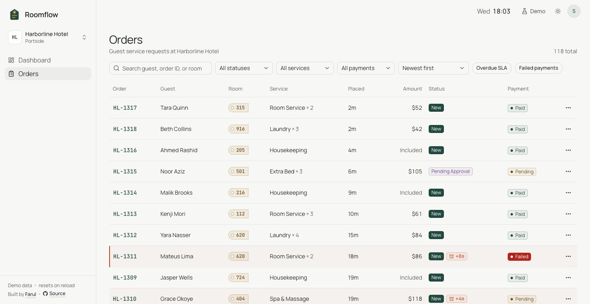

# Roomflow

A guest-service dashboard for hotel staff. Room service, housekeeping, laundry, extra-bed and spa requests from every hotel you work in arrive in one place. You can see what's waiting, act on it in a click or two, and spot the requests running late before the guest calls down.

**Live:** https://roomflow.farulivan.com | **Sign in:** click **Use demo account**, or use any email and a password of 6+ characters.



## Features

- **Three hotels, one console.** A hotel switcher scopes everything to one property. The hotel is part of the URL, so a shared link always opens the right one.
- **Dashboard:** today's orders hour by hour, with revenue and average order value; open orders, SLA breaches, active guests and completed orders; a "needs attention" queue; and the top services.
- **Orders list:**
  - search by guest, order ID or room
  - filters for status, service, payment and overdue orders, which combine
  - sorting and pagination
  - everything lives in the URL, so a filtered view can be shared or bookmarked
- **Order drawer** with the full details and the actions that order allows right now. It's routed, so it can be deep-linked.
- **Lifecycle actions:**
  - Acknowledge, Start and Complete update instantly and roll back if the server refuses.
  - Cancel and Reject ask first, wait for the server, and keep your note if something fails.
- **Per-service SLA targets.** A New room-service order is late after 10 minutes, a laundry pickup after 30. Late orders are flagged in the list, the drawer and the dashboard.
- **Approval flow:** an extra-bed request beyond the room's capacity waits for a manager to approve or reject it.
- **Payment follow-up:** taking on an order whose card was declined asks once, and "Mark payment collected", in the row menu or the order drawer, clears it from "Needs attention". Service is never blocked.
- **Live incoming orders** arrive as a toast with a View button. They never take focus away from what you're doing.
- **Loading, empty and error states with retry on every data view.** A failed background refresh keeps your data on screen and tells you how old it is.
- **Demo controls** in the header: automatic new orders, slow network, failing API, send an order now, reset the data.
- Mobile layout with a navigation drawer, dark mode, keyboard-reachable actions.

## Tech stack

| Tool                                                 | Why                                                                                          |
| ---------------------------------------------------- | -------------------------------------------------------------------------------------------- |
| [Bun](https://bun.sh) 1.3.5                          | Runtime, package manager and test runner in one, and fast at all three                       |
| React 19 + TypeScript (strict)                       | Components and hooks, with the compiler checking the contracts between layers                |
| Vite 8                                               | Instant dev server and a small production build                                              |
| Tailwind CSS v4 + [shadcn/ui](https://ui.shadcn.com) | Accessible Radix components that live in the repo, themed with my own tokens                 |
| [TanStack Query](https://tanstack.com/query) v5      | Server state: caching, polling, optimistic updates and rollback                              |
| [React Router](https://reactrouter.com) v8           | Hotel-scoped routes, list state in the URL, a routed details drawer                          |
| react-hook-form + [Zod](https://zod.dev) 4           | Form types come from the schema; Zod also checks the stored session and demo settings        |
| [MSW](https://mswjs.io) v2                           | A mock backend at the network boundary, so the app code is written exactly as for a real API |
| Recharts                                             | The orders-by-hour chart, loaded only with the dashboard                                     |
| `bun test` + Testing Library + happy-dom             | Fast unit, hook and component tests                                                          |
| Cloudflare Workers                                   | Serves the static build from the edge, on the same platform as the domain                    |

## Run locally

You need [Bun](https://bun.sh) 1.3.5 or later (`curl -fsSL https://bun.sh/install | bash`).

```bash
bun install
bun run dev     # open the URL Vite prints, usually http://localhost:5173
bun test
```

There's no backend to start and nothing to configure: the mock API runs inside the page.

| Command                           | What it does                           |
| --------------------------------- | -------------------------------------- |
| `bun run dev`                     | Start the dev server                   |
| `bun run build`                   | Type-check and build for production    |
| `bun run preview`                 | Serve the production build             |
| `bun test`                        | Run the tests                          |
| `bun run lint`                    | ESLint, with type-aware rules          |
| `bun run format` / `format:check` | Prettier, with Tailwind class sorting  |
| `bun run spell`                   | Spell-check code and docs              |
| `bun run typecheck`               | Type-check only                        |
| `bun run deploy`                  | Deploy the built `dist/` to Cloudflare |

The mock API runs in a service worker, which browsers only allow on `localhost` or over HTTPS. Opening the dev server from a phone at `http://192.168.x.x` shows an explanation instead of the app.

Commit and pull request conventions are in [CONTRIBUTING.md](CONTRIBUTING.md).

## Architecture

```
src/
  app/          router, providers, app shell, route guards, hotel scope
  components/   shadcn/ui primitives (ui/) and shared pieces like badges and RoomTag (shared/)
  domain/       business rules as plain TypeScript: lifecycle, SLA, list queries, metrics
  features/     auth, dashboard, hotels, orders, simulator
  lib/          API client, config, paths, query client, formatters, the shared clock
  mocks/        the MSW backend: handlers, in-memory database, seed data
```

Code depends in one direction: UI → query hooks → API client → domain. The domain imports nothing and holds every business rule, and the mock backend reuses the same functions. That's why the UI and the API can't disagree about which status changes are legal.

Each feature keeps the same file roles: `api.ts` for endpoints, `queries.ts` and `mutations.ts` for data hooks, then components. Components either show data (badges, amounts, empty states) or compose a page; they don't fetch on their own.

The full write-up is in [docs/ARCHITECTURE.md](docs/ARCHITECTURE.md).

## State management

- **Server state lives only in TanStack Query.** That covers hotels, orders, a single order and metrics. Every key starts with the hotel ID, so each hotel has its own cache and switching back is instant.
- **View state lives in the URL:** the current hotel in the path; search, filters, sort and page in the query string. Typing in the search box replaces the history entry, and a filter change adds one, so Back undoes filters, not keystrokes.
- **Preferences live in `localStorage`** and are checked when read back, so a bad value falls back to a default: the session, theme, demo settings and last-used hotel.
- **Everything else is local component state**, such as an open dialog or the search draft.

There's no global store library, because nothing is left for one to hold.

## Data approach

The app talks to a REST API under `/api/hotels/:hotelId/...`. In this build, [MSW](https://mswjs.io) answers those requests from an in-memory database seeded with three fictional hotels: 118, 68 and 38 orders. Timestamps are relative to now, so every hotel opens mid-shift with late orders, an approval waiting and failed payments to chase. Your changes last until a full reload.

Every response goes through one wrapper that adds realistic latency. The demo controls make it slow (about 2 s) or make every request fail with HTTP 500, so the loading, error and rollback paths can be seen on demand.

Swapping in a real API takes four steps:

1. Change `apiBaseUrl` in `src/lib/config.ts`.
2. Remove the mock bootstrap from `src/main.tsx`.
3. Delete `src/mocks` and the demo-only simulator.
4. Replace the mock sign-in.

The query hooks, components and domain stay as they are.

## Design decisions

**Slow API.** The first load shows skeletons in the final layout, so nothing jumps when data lands. After that, changing a filter or page keeps the current rows on screen, slightly dimmed, until the new ones arrive. That never carries over between hotels: after a switch you get a skeleton, never the previous hotel's orders.

**A failed status change.** Quick steps like Acknowledge or Start are optimistic, because they're easy to retry and staff do them all day. If the server refuses, only that order goes back, so another order you changed in the meantime keeps its change, and a toast says what was reverted. Cancel and Reject can't be undone, so they don't pretend: the dialog waits for the server, shows the error inside itself if one comes, and keeps the reason you typed.

**A declined payment.** In a hotel, serving an order and getting paid for it are separate jobs, often done by different people at different moments. The billing check happens when the order is taken, a guest who can't charge to the room pays at delivery, and a declined card is the front office's to sort out. So a declined payment never blocks service: a guest waiting on a cold tray to protect a $40 charge is the worse outcome. Instead, acknowledging or approving the order asks once, so nobody takes it on without knowing, and "Mark payment collected" gives the follow-up an end, whenever the money comes in: before the order is taken on, at delivery, or after it's completed. It sits in the same row menu as every other action, and in the order drawer. Until then the order stays in "Needs attention". A complimentary order never has a payment to chase.

**A new order arriving mid-action.** It appears as a toast that doesn't take focus, with a View button, and the list refreshes in the background. Whatever you're in the middle of survives the refresh:

- The cancel dialog sits above the list with its own copy of the order, so a row moving to page 2 doesn't close it.
- The drawer is tied to the order ID in the URL, not to a row.
- The search box never overwrites what you're still typing.

**Several hotels.** The hotel is in the URL path and in every API path and query key. The mock database stores all orders in one table with a hotel column and scopes every lookup. Asking for another hotel's order returns the same 404 as an order that doesn't exist. Switching hotels keeps you in the same section and clears filters and any open order, since those belonged to the hotel you left.

**10,000 orders.** Search, filters, sorting and paging already happen behind the API, so the browser still renders one page of 10. The work would move to the server: indexed search instead of a scan, cursor pagination instead of offsets, and pre-computed metrics. Virtualizing the table isn't worth it while a page is 10 rows.

**Before production:**

- real authentication, with per-hotel roles checked on the server (today anyone signed in can approve)
- a push channel (SSE or WebSocket) instead of 30-second polling
- error reporting, plus a real analytics provider behind the existing `track()` call
- storing cancel and reject reasons in an audit log
- end-to-end tests for the main flows
- rate limiting on the API

**Deliberately not doing:**

- **Row virtualization:** pages are 10 rows.
- **A global state library:** the cache and the URL already hold all the state.
- **Real sign-in:** there's no server to trust, so the mock only shows the protected-route pattern.
- **Saving demo data across reloads:** a fresh, time-relative seed never goes stale.
- **A push transport:** polling sits behind the same query keys, so it can be swapped later without touching the UI.

## Working with AI

I build with [Claude Code](https://claude.com/claude-code) as an assistant. I set the direction for this project: what it does, how it's structured, how it looks, and what it deliberately leaves out. Claude Code takes on the work that doesn't need those decisions, like drafting components and tests, carrying out refactors, and checking the docs against the code. I review, run and test every change before it lands, and I rework or reject what doesn't meet my bar. The decisions, and the responsibility for them, are mine.

## What I'd improve next

- Show each hotel's times in its own time zone (today everything uses the browser's)
- Keyboard shortcuts for the common actions (A to acknowledge, S to start)
- Group the needs-attention list by reason, with counts
- End-to-end tests with Playwright for acknowledge → start → complete and the cancel flow

### Not built yet

- Cancel and reject reasons are sent to the API but not stored or shown anywhere.
- All amounts are in USD. There's no per-hotel currency.
- There are no roles: every signed-in user can approve extra beds and mark payments collected.

## License

[MIT](LICENSE)
