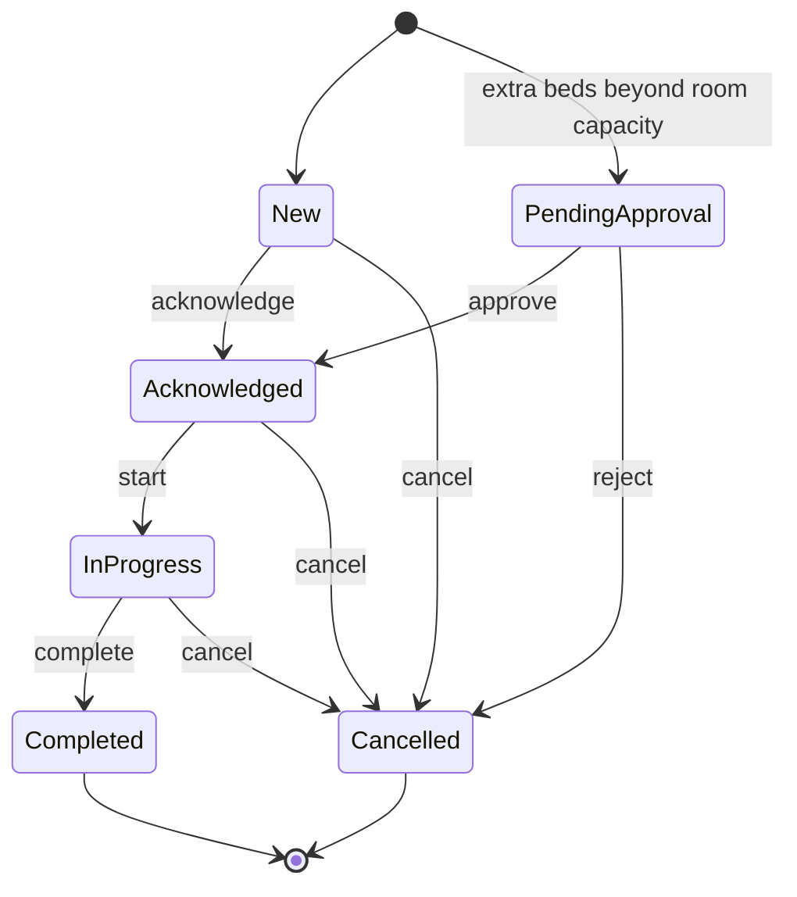

# Architecture

How Roomflow is put together, and why. The [README](../README.md) covers what the app does and how to run it.

## Tech stack

| Choice                                 | Why                                                                                                                       |
| -------------------------------------- | ------------------------------------------------------------------------------------------------------------------------- |
| React 19 + TypeScript (strict)         | Function components and hooks throughout; the compiler catches contract drift between layers                              |
| Bun 1.3.5                              | Runtime, package manager and test runner in one tool; scripts run on the Bun runtime (`bunx --bun`), so Node isn't needed |
| Vite 8                                 | Dev server and production bundling                                                                                        |
| Tailwind CSS v4 + shadcn/ui            | Utility styling plus accessible Radix-based components that live in this repo (`src/components/ui`), free to edit         |
| TanStack Query v5                      | All server state: caching, polling, optimistic updates                                                                    |
| React Router v8 (data router)          | Hotel-scoped routes, URL-driven list state, a routed details drawer                                                       |
| react-hook-form + Zod 4                | Schema-first forms; Zod also validates the session and demo settings read back from `localStorage`                        |
| MSW v2 (browser)                       | The backend: intercepts real `fetch` calls at the network boundary, in dev and in the deployed build                      |
| Recharts (via shadcn charts)           | The two dashboard charts; lazy-loaded with the dashboard route                                                            |
| bun test + Testing Library + happy-dom | Unit tests for the domain and mock database, component and hook tests for the UI                                          |
| Cloudflare Workers (static assets)     | Hosting: the built files served from the edge, with the custom domain on the same account                                 |

## Layers

Dependencies point one way. The network boundary is where a real backend would replace the mock one.

```
┌────────────────────────────────────────────────────────────────────┐
│ UI            src/app, src/features/*/*.tsx, src/components        │  renders state, fires callbacks
├────────────────────────────────────────────────────────────────────┤
│ Server state  src/features/*/queries.ts, mutations.ts              │  query keys, caching, optimistic updates
├────────────────────────────────────────────────────────────────────┤
│ API client    src/lib/api-client.ts + src/features/*/api.ts        │  typed endpoints, ApiError
├────────────────────────────────────────────────────────────────────┤
│ Domain        src/domain: plain TypeScript, imports only itself    │  types, lifecycle, SLA, list queries, metrics
└────────────────────────────────────────────────────────────────────┘
     ↕ network boundary (fetch)
┌────────────────────────────────────────────────────────────────────┐
│ Mock server   src/mocks (MSW): reuses the domain for validation,   │  started only from main.tsx
│               filtering and metrics                                │
└────────────────────────────────────────────────────────────────────┘
```

Rules the code follows:

- `src/domain` imports nothing outside itself: no React, no libraries. Every rule in it is unit-tested without a DOM.
- All HTTP goes through `request()` in `src/lib/api-client.ts`. Each feature's `api.ts` defines typed endpoint functions. No `fetch` in components.
- The mock server enforces the same rules the UI uses (`canTransition`, `applyOrderQuery`, `computeMetrics`), so the two sides of the wire can't disagree.
- Only `main.tsx` imports from `src/mocks`.
- `src/app` is the composition layer (router, providers, shell, route guards). Features don't import from it; shared URL building lives in `src/lib/paths.ts` for that reason.

### Deliberately not doing

No Redux or Zustand: TanStack Query and the URL already hold all the state there is. No repository pattern or DI container. No state-machine library for a six-status transition map, because a typed record does it. No barrel files. An abstraction has to make something testable or swappable to earn its place.

## Folder structure

```
src/
  app/          # router, providers, app shell, route guards, hotel scope, status screens
  components/
    ui/         # shadcn/ui primitives (CLI-generated, then themed)
    shared/     # badges, RoomTag, BrandMark, empty/error/stale-data states, page header
  domain/       # business rules and shared types, fully unit-tested
  features/
    auth/       # login page, session context, login schema
    dashboard/  # KPI cards, charts, needs-attention list (lazy-loaded route)
    hotels/     # hotel list query, current-hotel context, hotel switcher
    orders/     # list page, toolbar, table and cards, details sheet, actions, confirm dialog
    simulator/  # demo controls and the incoming-order simulation
  lib/          # api-client, config, paths, query client, demo settings, formatters, shared clock
  mocks/        # MSW worker, handlers, in-memory db, hotel profiles, seed data
  test/         # test preload, factories, render helper
```

Each feature keeps the same file roles: `api.ts` (endpoints), `queries.ts` (query keys and read hooks), `mutations.ts` (write hooks), then components.

## Domain model

```ts
interface Hotel {
  id: string // "harborline", used in URLs and API paths
  code: string // "HL", prefixes the hotel's order IDs
  name: string
  city: string
}

type ServiceType =
  "Room Service" | "Housekeeping" | "Laundry" | "Extra Bed" | "Spa & Massage"
type OrderStatus =
  | "New"
  | "Pending Approval"
  | "Acknowledged"
  | "In Progress"
  | "Completed"
  | "Cancelled"
type PaymentStatus = "Paid" | "Pending" | "Failed"

interface Order {
  id: string // "HL-1042"
  hotelId: string
  guestName: string
  roomNumber: string
  service: ServiceType
  quantity: number
  amount: number // USD; complimentary services are 0
  specialRequest: string
  orderTime: string // ISO timestamp
  status: OrderStatus
  paymentStatus: PaymentStatus
}
```

### Order lifecycle

One typed transition map (`src/domain/order-status.ts`) drives everything. The UI renders only the actions the map allows, and the mock API rejects anything else with HTTP 422. A test keeps the action list and the transition map in agreement.



Each action carries its UI metadata: label, past-tense label for the toast, intent, and whether it needs confirmation. Destructive actions (Cancel, Reject) always confirm.

### Business rules (`src/domain`)

- **SLA.** An order breaches its SLA when it stays in `New` longer than its service's target (`SLA_TARGET_MINUTES`): Room Service 10 min, Spa & Massage 15, Housekeeping 20, Extra Bed 20, Laundry 30. Later statuses count as in hand.
- **Approval.** `initialStatusFor()` sends an Extra Bed request above `EXTRA_BED_CAPACITY` (2) to `Pending Approval` instead of `New`.
- **Payment follow-up.** `needsPaymentFollowUp()` (`src/domain/payment.ts`) is true while a declined payment still has to be collected: the order isn't cancelled and isn't complimentary. While it holds, `actionsForOrder()` makes Acknowledge and Approve ask for confirmation first; later steps stay one click. It's also the only time the API accepts "Mark payment collected".
- **Metrics** (`computeMetrics`, "today" = local calendar day):
  - active guests = distinct rooms with a non-cancelled order today
  - open orders = everything not Completed or Cancelled
  - revenue today = paid, non-cancelled orders today
  - average order value = that revenue over the paid orders behind it, with complimentary $0 orders left out
  - needs attention = SLA breaches, then pending approvals, then orders where `needsPaymentFollowUp()` holds. A completed order whose payment failed still owes money, so it stays listed until the payment is collected.

## Mock API

MSW intercepts `fetch` in a service worker, so the app is written exactly as it would be against a real backend, and the deployed build ships the same mock. Every route is scoped to a hotel:

| Endpoint                                             | Behavior                                                                                                                                         |
| ---------------------------------------------------- | ------------------------------------------------------------------------------------------------------------------------------------------------ |
| `GET /api/hotels`                                    | The hotels this account can work in                                                                                                              |
| `GET /api/hotels/:hotelId/orders`                    | Query params `search`, `status`, `service`, `payment`, `sla`, `sort`, `page`, `pageSize`. Returns `{ items, total, page, pageSize, totalPages }` |
| `GET /api/hotels/:hotelId/orders/:orderId`           | One order, or 404                                                                                                                                |
| `PATCH /api/hotels/:hotelId/orders/:orderId/status`  | Body `{ status, reason? }`; checked against the transition map; 422 with a message when illegal                                                  |
| `PATCH /api/hotels/:hotelId/orders/:orderId/payment` | Body `{ status: "Paid" }`: records a collected payment; 422 when there is nothing to collect, 400 for any other status                           |
| `GET /api/hotels/:hotelId/metrics`                   | Dashboard metrics and the needs-attention list                                                                                                   |
| `POST /api/hotels/:hotelId/demo/orders`              | One realistic incoming order (the live simulation)                                                                                               |
| `POST /api/demo/reset`                               | Reseeds every hotel                                                                                                                              |

**Tenant isolation.** A second catch-all handler returns 404 for an unknown hotel before any hotel route runs. `src/mocks/db.ts` is one orders table with a `hotelId` column, and every read is scoped to a hotel. An order that belongs to another hotel returns the same 404 as one that doesn't exist, so the API never confirms what another tenant holds. `src/mocks/db.test.ts` covers this.

**Simulated conditions.** A catch-all handler runs before every endpoint (in MSW, a handler that returns nothing passes the request on). It adds 250 to 600 ms of latency normally and about 2 s in "slow network" mode, and returns HTTP 500 for every request in "API errors" mode. The settings live in `src/lib/demo-settings.ts` and are toggled from the demo controls in the header.

**Seed data.** Three fictional hotels with their own room layouts and volumes: Harborline Hotel (118 orders), Cedarfall Lodge (68) and Saltmarsh House (38). Each has its own PRNG seed, and timestamps are relative to "now", so every hotel opens mid-shift with SLA breaches, a pending approval and failed payments in view. Hand-placed orders guarantee those stories, and a test checks that every hotel shows them. Changes live in memory for the session; a full reload reseeds.

**Replacing the mock with a real API** takes these steps:

1. Point `apiBaseUrl` in `src/lib/config.ts` at the real API.
2. Remove `enableMocking()` from `src/main.tsx` and delete `src/mocks`.
3. Remove the demo layer, which only exists for the mock:
   - `src/features/simulator`: `DemoControls` in the router and `useOrderSimulator` in `AppShell`
   - `src/lib/demo-settings.ts` and `use-demo-settings.ts`
   - the "turn off simulated errors" button in `src/app/hotels-gate.tsx`
4. Replace the mock login in `src/features/auth/auth-context.tsx` with real authentication.

Query hooks, components and the domain don't change.

## State management

| Kind         | Where it lives                  | Examples                                                   |
| ------------ | ------------------------------- | ---------------------------------------------------------- |
| Server state | TanStack Query only             | hotels, orders list, order detail, metrics                 |
| View state   | the URL                         | current hotel (path), search, filters, sort, page (query)  |
| Preferences  | `localStorage`, checked on read | session, theme, demo settings, last-used hotel             |
| UI state     | component state                 | open dialogs, the search draft, the order awaiting confirm |

**Query keys** start with the hotel, so each hotel has its own cache:

- `["hotels"]`
- `["orders", hotelId, "list", params]`
- `["orders", hotelId, "detail", id]`
- `["metrics", hotelId]`

The orders list and metrics poll every 30 s, as a stand-in for a push transport.

The list keeps the previous page on screen while the next loads, but only within one hotel. After a hotel switch the old hotel's rows never stand in for the new one's (`src/features/orders/queries.ts`).

**Status changes** (`src/features/orders/mutations.ts`):

- **Quick, reversible steps** (Acknowledge, Approve, Start, Complete) are optimistic. The new status shows at once. On failure only that order is put back, so a change to another order made in the meantime survives, and a toast says the change was reverted.
- **Confirmed steps** (Cancel, Reject) wait for the server. The dialog stays open with a spinner and shows a failure inline, keeping the typed reason.
- The confirm dialog lives once per page in `ConfirmActionProvider`, above the list. It keeps its own copy of the order, so a row that moves or disappears in a refresh doesn't take the dialog with it.

**One clock.** `useNow()` (`src/lib/use-now.ts`) is a module-level store read with `useSyncExternalStore`. Every SLA badge and relative time reads the same `Date` from one 30-second timer, which runs only while something is subscribed.

## Error handling

- **Every data surface has four states:**
  - loading: skeletons in the final layout
  - empty: "no orders yet" is told apart from "nothing matches your filters", which comes with a clear-filters action
  - error: a message and a retry
  - success
- **A failed background refresh** keeps the data on screen, with a "Couldn't refresh. Showing data from HH:MM." notice and a Retry button, instead of replacing the view.
- **Full-page fallbacks:**
  - Route errors land on an error page.
  - Unknown URLs and unknown hotels get a not-found page.
  - An order from another hotel gets a specific message in the drawer.
- **Startup failures:**
  - If the hotel list can't load, a full-page screen offers a retry. If simulated API errors are on, it also offers a way to turn them off.
  - If the service worker can't start (for example, the dev server opened over plain HTTP on a LAN address), the app explains why instead of rendering a blank page.

## Forms and validation

Zod schemas are the single source of truth, and form types are derived with `z.infer`. `react-hook-form` validates through `zodResolver`, with inline messages and `aria-invalid` on failing fields. The same approach guards stored data. A malformed session is treated as signed out, and each demo setting falls back to its default on its own.

## Conventions

- Business rules and their constants live in `src/domain`, next to their types. App configuration (poll intervals, storage keys, the API base URL) lives in `src/lib/config.ts`. Small presentation constants, like the search debounce, stay in the component that uses them.
- Shared domain and API types live in `src/domain`. Component prop interfaces stay in the component file.
- Anything that encodes a business rule belongs in `src/domain`, with a test. Presentation formatters live in `src/lib/format.ts`.
- Comments explain why, not what.

## Testing

- **Domain:** every transition pair, SLA boundaries per service, initial status, list querying (search, combined filters, sorting, pagination maths, the URL codec), and metrics against a fixed fixture.
- **Mock database:** tenant isolation, per-hotel ID sequences, and a check that each hotel's seed shows every dashboard story.
- **UI:**
  - search keeps a trailing space through the debounced URL update, with the right history behavior
  - typing a cancel reason from a row's menu doesn't navigate away
  - optimistic rollback restores only the failed order
  - confirmed actions don't touch the cache before the server answers
  - the shared clock runs one timer
  - acknowledging an order with a declined payment asks first, and collecting a payment rolls back only that order on failure
  - the row menu offers "Mark payment collected" while a payment is owed, including on completed orders, and has no menu once nothing is left to do
  - which actions render for each status

## Accessibility

- Semantic table markup with a screen-reader caption, and every input labeled.
- Rows and cards navigate through real links, so middle-click and cmd-click work. On mobile, the card's link is stretched over the card rather than wrapped around its action buttons.
- Radix primitives handle focus trapping, focus restoration and Escape in the drawer, menus and dialogs. Toasts announce through a live region.
- A skip link comes before the navigation. Motion is turned off under `prefers-reduced-motion`.
- Color is never the only signal: badges pair color with text, and SLA flags pair it with an icon and the minutes overdue.

## Deployment

The app is a static build, served by Cloudflare Workers with no Worker script (`wrangler.jsonc`):

- **Routing:** `not_found_handling: "single-page-application"` returns `index.html` for any unknown path, so deep links like `/hotels/harborline/orders/HL-1042` load directly.
- **Caching:** `public/_headers` marks the fingerprinted files in `/assets` as immutable for a year. `index.html` and the service worker always revalidate, so a new deploy shows up on the next load.
- **Addresses:** the custom domain is the only public address. Each uploaded version also gets its own `workers.dev` preview URL for checking a change before it goes live.
- **Releases:** Cloudflare builds and deploys every push to `main`. `bun run deploy` does the same by hand from a local `dist/`.

## Performance and scale

- The dashboard and its charting library are a separate chunk, loaded on first visit.
- Filtering, sorting and pagination already happen on the server side of the API, so the client renders one page of 10 however many orders exist.
- At real scale, the changes are all server-side:
  - indexed search instead of a linear scan
  - cursor pagination instead of offset
  - pre-aggregated metrics
- Row virtualization only becomes worth it if page sizes grow well past what fits on screen.
